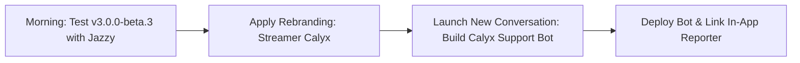

# 🌿 Streamer Calyx: Application Rebranding & Full Autonomous Support Agent Blueprint

> **Prepared for**: ThaWizanator  
> **Status**: Comprehensive Master Blueprint & Architecture Specification  
> **Target Release**: Post-Beta 3 Transition / v3.0.0 Milestone  

---

## 🧭 Executive Summary

The application has outgrown its original identity. What began as a lightweight screen-border indicator (**HotKey Overlay Alert**) has evolved into a full-featured, backstage broadcast suite:
1. **Visual Highlight HUD & HotKey Monitor** (Display border alerts, active audio states, macro feedback).
2. **Stream Director & Remote Co-Host Dock** (Floating physical monitor dock, real-time scene control, live audio mixer faders).
3. **Encrypted WebRTC P2P & Bouncer Security** (Zero-port-forward WAN streaming control, cryptographic passkeys, Windows-style granular permissions).
4. **Twitch Broadcaster Automation** (Chat integration, live channel state sync, co-host permission mapping).
5. **OBS Studio & Streamlabs Desktop (SLOBS) Dual-Bridge** (Simultaneous WebSocket and Local Named Pipe drivers).

The name **Streamer Calyx** represents this expanded vision. In botany, the *calyx* is the protective outer whorl of sepals that encloses, shields, and supports the budding flower as it blossoms. Similarly, **Streamer Calyx** is the protective, backstage command center that supports streamers and their co-hosts before and during live broadcasts.

This document covers two major architectural pillars:
- **Part 1**: The end-to-end **App Renaming & Migration Blueprint** (codebase, zero-downtime user data migration, updater pipeline, executable branding).
- **Part 2**: The **Full Autonomous Support & Triage Agent** (evaluation of existing tools vs. custom microservice, Gemini/Claude integration, Discord modals, and bidirectional GitHub Issues sync).
- **Part 3**: **Implementation Workflow & Dedicated Conversation Strategy**.

---

# Part 1: Rebranding to "Streamer Calyx"

```
[ Old Identity ]                              [ New Identity ]
HotKey Overlay Alert        ──────────────►   Streamer Calyx
HotKeyOverlayAlert.exe      ──────────────►   StreamerCalyx.exe
%APPDATA%\ThaWizanator_Overlay ───────────►   %APPDATA%\StreamerCalyx (Auto-Migrated)
thawizanator.hotkeyoverlayalert ──────────►   thawizanator.streamercalyx
```

---

## 1.1 Complete Codebase Impact Map

A full search across the active source tree identified **68 references** across **13 files** that require structured updating:

| File | Current Reference | Proposed "Streamer Calyx" Update |
| :--- | :--- | :--- |
| [main.py](file:///E:/_DEV/App-%20Streamer%20Tool%20-%20Hothey%20monitor%20highlight/_monitior%20highlight/main.py) | `app_name = "HotKeyOverlayAlert"` | `app_name = "StreamerCalyx"` |
| [main.py](file:///E:/_DEV/App-%20Streamer%20Tool%20-%20Hothey%20monitor%20highlight/_monitior%20highlight/main.py) | AppUserModelID: `thawizanator.hotkeyoverlayalert.app...` | `thawizanator.streamercalyx.app...` |
| [main.py](file:///E:/_DEV/App-%20Streamer%20Tool%20-%20Hothey%20monitor%20highlight/_monitior%20highlight/main.py) | AppData: `ThaWizanator_Overlay` | `StreamerCalyx` *(with automatic migration fallback)* |
| [main.py](file:///E:/_DEV/App-%20Streamer%20Tool%20-%20Hothey%20monitor%20highlight/_monitior%20highlight/main.py) | Windows Startup RegKey: `HotKeyOverlayAlert` | `StreamerCalyx` *(with cleanup of legacy key)* |
| [main.py](file:///E:/_DEV/App-%20Streamer%20Tool%20-%20Hothey%20monitor%20highlight/_monitior%20highlight/main.py) | System Tray tooltip: `"HotKey Overlay Alert"` | `"Streamer Calyx"` |
| [main.spec](file:///E:/_DEV/App-%20Streamer%20Tool%20-%20Hothey%20monitor%20highlight/_monitior%20highlight/main.spec) | Executable target: `name='HotKeyOverlayAlert'` | `name='StreamerCalyx'` |
| [version_info.txt](file:///E:/_DEV/App-%20Streamer%20Tool%20-%20Hothey%20monitor%20highlight/_monitior%20highlight/version_info.txt) | ProductName / OriginalFilename | `Streamer Calyx` / `StreamerCalyx.exe` |
| [updater.py](file:///E:/_DEV/App-%20Streamer%20Tool%20-%20Hothey%20monitor%20highlight/_monitior%20highlight/updater.py) | Asset match: `if "hotkeyoverlayalert" in name:` | `if "streamercalyx" in name or "hotkeyoverlayalert" in name:` |
| [updater.py](file:///E:/_DEV/App-%20Streamer%20Tool%20-%20Hothey%20monitor%20highlight/_monitior%20highlight/updater.py) | Process kill: `Get-Process "HotKeyOverlayAlert"` | `Get-Process -Name "StreamerCalyx", "HotKeyOverlayAlert"` |
| [settings_ui.py](file:///E:/_DEV/App-%20Streamer%20Tool%20-%20Hothey%20monitor%20highlight/_monitior%20highlight/settings_ui.py) | Window Title: `"HotKey Overlay Alert - Streamer Hub"` | `"Streamer Calyx - Streamer Hub"` |
| [settings_ui.py](file:///E:/_DEV/App-%20Streamer%20Tool%20-%20Hothey%20monitor%20highlight/_monitior%20highlight/settings_ui.py) | Brand Label: `"HotKey Overlay"` | `"Streamer Calyx"` |
| [diagnostics.py](file:///E:/_DEV/App-%20Streamer%20Tool%20-%20Hothey%20monitor%20highlight/_monitior%20highlight/diagnostics.py) | AppData path & report header | Updated to `StreamerCalyx` |
| [debug_logger.py](file:///E:/_DEV/App-%20Streamer%20Tool%20-%20Hothey%20monitor%20highlight/_monitior%20highlight/debug_logger.py) | Crash Dialog Window Title & Header | Updated to `"Streamer Calyx - Crash Detected"` |
| [director_tab.py](file:///E:/_DEV/App-%20Streamer%20Tool%20-%20Hothey%20monitor%20highlight/_monitior%20highlight/director_tab.py) | Tooltips & guidance text | Updated to `"Streamer Calyx"` |

---

## 1.2 Zero-Downtime User Data Migration Architecture

> [!IMPORTANT]
> **Zero Configuration Loss Requirement**: Existing users (ThaWizanator, Jazzy/purplen3rd, and community testers) already have customized `config.json`, Twitch tokens, director scenes, and co-host permissions in `%APPDATA%\ThaWizanator_Overlay`. A naive folder rename would cause the new version to start with empty defaults.

### Proposed Automated Migration Routine:
We will add an automatic, one-time migration hook in `main.py` at application boot before any configuration files are read:

```python
def get_app_data_directory() -> str:
    """
    Returns the target AppData directory for Streamer Calyx (%APPDATA%\\StreamerCalyx).
    Automatically migrates legacy settings from %APPDATA%\\ThaWizanator_Overlay
    if present, ensuring seamless zero-downtime upgrades.
    """
    appdata_root = os.environ.get("APPDATA", "")
    new_dir = os.path.join(appdata_root, "StreamerCalyx")
    old_dir = os.path.join(appdata_root, "ThaWizanator_Overlay")

    # If new folder does not exist but legacy folder exists, migrate all files
    if not os.path.exists(new_dir) and os.path.exists(old_dir):
        try:
            import shutil
            shutil.copytree(old_dir, new_dir)
            log_debug("MIGRATION", f"Successfully migrated legacy config from {old_dir} to {new_dir}")
        except Exception as e:
            log_debug("MIGRATION", f"Failed to copy legacy directory: {e}. Falling back to legacy path.")
            return old_dir

    os.makedirs(new_dir, exist_ok=True)
    return new_dir
```

### Windows Startup Registry Clean-Up:
In `main.py`, the Windows startup registry function will be updated to:
1. Register `StreamerCalyx` pointing to the new executable path.
2. Remove any lingering legacy `HotKeyOverlayAlert` registry key in `HKCU\Software\Microsoft\Windows\CurrentVersion\Run`.

---

## 1.3 In-App Updater Continuity & GitHub Transition

When existing installations of `HotKeyOverlayAlert.exe` check for updates, the in-app updater downloads the latest asset from GitHub releases. To ensure smooth auto-updating from `HotKeyOverlayAlert.exe` &rarr; `StreamerCalyx.exe`:

1. **Dual Asset Matching**:
   In [updater.py](file:///E:/_DEV/App-%20Streamer%20Tool%20-%20Hothey%20monitor%20highlight/_monitior%20highlight/updater.py), the asset discovery logic will be updated to match either name:
   ```python
   target_asset = None
   for asset in release.get("assets", []):
       name = asset.get("name", "").lower()
       if ("streamercalyx" in name or "hotkeyoverlayalert" in name) and name.endswith(".exe"):
           target_asset = asset
           break
   ```
2. **PowerShell Update Script Process Termination**:
   The self-updating script (`updater.ps1`) will wait for both process names:
   ```powershell
   $running = Get-Process -Name "StreamerCalyx", "HotKeyOverlayAlert" -ErrorAction SilentlyContinue
   ```
3. **Executable Name Transition**:
   The updater script replaces the currently running executable directly at its exact current location (e.g., `C:\Users\thawi\Desktop\HotKeyOverlayAlert.exe` or `StreamerCalyx.exe`), creating a new Desktop shortcut for **Streamer Calyx** if desired.

---

# Part 2: The "Full Autonomous Suite" for Bug Reports & Feedback

```
┌─────────────────────────────────────────────────────────────────────────────┐
│                            STREAMER CALYX USER                              │
│                                                                             │
│   [ In-App 1-Click Reporter ]                    [ Discord Community ]      │
│   • Diagnostics bundle                           • Channel: #bug-reports    │
│   • Sanitized logs                               • Slash Command: /bug      │
└───────────────────────┬──────────────────────────────────────┬──────────────┘
                        │                                      │
                        ▼                                      ▼
┌─────────────────────────────────────────────────────────────────────────────┐
│               CALYX SUPPORT & TRIAGE AGENT (Python Microservice)            │
│                                                                             │
│   1. Security Redactor (Strips OAuth, passkeys, local user paths)           │
│   2. Gemini 1.5 Flash AI Engine (Stack-trace diagnosis, known-bug matching) │
│   3. Duplicate Issue Detector                                               │
└───────────────────────┬──────────────────────────────────────┬──────────────┘
                        │                                      │
                        ▼                                      ▼
┌──────────────────────────────────┐        ┌─────────────────────────────────┐
│          GITHUB ISSUES           │        │      DISCORD FORUM THREAD       │
│                                  │◄──────►│                                 │
│  • Auto-creates Issue #42        │ Status │  • Thread: [Issue #42] Crash... │
│  • Applies labels (bug, p2p, ...)│ Sync   │  • Pings user with live updates │
│  • Assigns milestone & project   │        │  • Posts AI diagnosis & fix link│
└──────────────────────────────────┘        └─────────────────────────────────┘
```

---

## 2.1 Existing Tools vs. Building From the Ground Up

| Solution | Interactive Discord Modals? | GitHub Issue Creation? | AI Stack-Trace Triage? | Token Sanitization? | Monthly Cost | Verdict |
| :--- | :---: | :---: | :---: | :---: | :---: | :--- |
| **Official "GitHub for Discord"** | ❌ No | ❌ One-way only (GitHub &rarr; Discord) | ❌ No | ❌ No | Free | **Inadequate**: Cannot intake bugs from users. |
| **Zapier / Make.com** | ❌ No native forms | ⚠️ Basic webhook | ❌ No (requires expensive add-ons) | ❌ No | \$20–\$50/mo | **Not recommended**: Clunky, costly, no custom logic. |
| **Generic Ticket Bots** | ⚠️ Generic tickets | ❌ No GitHub sync | ❌ No | ❌ No | Free / Paid | **Wrong tool**: Built for human server moderation. |
| **Custom Calyx Support Bot** | ✅ Native `/bug` & `/feedback` | ✅ Full 2-way sync (PyGithub) | ✅ Deep Gemini Flash AI | ✅ Custom Regex Redactor | **100% Free** | **🏆 GOLD STANDARD (Recommended)** |

### Why Building from the Ground Up is the Right Choice:
1. **Lightweight & Clean**: It is **not** a massive project. A complete, production-ready Python bot with Discord modals, GitHub sync, and Gemini AI triage is only **~350–450 lines of Python code** across 4 modules.
2. **Zero Hosting Cost**: Runs easily on:
   - Free VPS tier (Oracle Cloud Always Free, Railway hobby credit, Fly.io)
   - Or directly in a Docker container or background service on your streaming PC/home server.
3. **100% Tailored to Streamer Calyx**:
   - Understands our specific log structure (`debug.txt`, `crash_log.txt`, `bug_report_bundle.txt`).
   - Knows about Streamlabs Named Pipes, WebRTC P2P passkeys, and Twitch OAuth tokens.
4. **Data Privacy**: No 3rd party SaaS touches your community's logs or private tokens.

---

## 2.2 The Gemini / Claude Integration (Zero Prior Setup Needed)

You mentioned: *"then the gemini/claude integration, we do not have anything in place yet"*.
Here is how simple and accessible this is to set up:

### Why Gemini 1.5 Flash is Ideal for this Triage Agent:
- **Cost**: **100% Free** on Google AI Studio (up to 15 requests per minute, 1,000,000 tokens per minute for free).
- **Context Window**: **1,000,000 tokens**. It can ingest the entire `bug_report_bundle.txt` (thousands of lines) and compare it against the Streamer Calyx architecture without truncation.
- **Latency**: Sub-second (~800ms) response times.

### How the AI Agent Works in Practice:
When a user submits a bug report via Discord or in-app:
```python
# ai_triage.py (Concept)
import google.generativeai as genai

genai.configure(api_key=os.getenv("GEMINI_API_KEY"))
model = genai.GenerativeModel("gemini-1.5-flash")

SYSTEM_PROMPT = """
You are the Calyx Triage AI Assistant for the desktop app 'Streamer Calyx'.
You inspect crash logs and bug descriptions to:
1. Identify the exact root cause (module, line number, exception).
2. Check if this is a known issue (e.g. QTimer import, Streamlabs Remote Control disabled, port 59650 closed).
3. Provide a friendly 2-paragraph diagnosis:
   - Paragraph 1: What caused the issue in plain English.
   - Paragraph 2: Immediate troubleshooting step for the user, or note if a fix is already committed.
"""

def analyze_bug_report(title, description, log_content):
    prompt = f"Title: {title}\nDescription: {description}\n\nLog Content:\n{log_content}"
    response = model.generate_content([SYSTEM_PROMPT, prompt])
    return response.text
```

### Real-World Example of What the User Sees in Discord:
> **User purplen3rd**: `/bug` -> *"Clicked to change scene, got an alert crash"* (attaches screenshot/log)  
> **Calyx Bot**:  
> Creates GitHub Issue **#42: NameError: name 'QTimer' is not defined**  
> Creates Discord Thread: **#42 - NameError QTimer**  
> **Bot replies in thread**:  
> > 🤖 **Calyx AI Diagnosis**:  
> > *"This crash occurred in `director_tab.py` at line 2040 because `QTimer` was missing from the module imports when handling P2P commands.*  
> > *💡 **Status**: This issue is already resolved in commit `d8ddd16` and is packaged into the upcoming `v3.0.0-beta.4` build! You do not need to do anything further."*

---

## 2.3 Bot Architecture & Module Breakdown

If we build the Full Autonomous Suite, here is the exact project layout:

```
calyx-support-bot/
├── bot.py                  # Discord client, slash commands (/bug, /feedback), modal popups
├── github_sync.py          # PyGithub client: creates issues, applies labels, syncs status
├── ai_triage.py            # Gemini 1.5 Flash client: parses logs, diagnoses root causes
├── sanitizer.py            # Security regex engine: strips tokens, passkeys, user paths
├── webhook_listener.py     # FastAPI server: receives GitHub webhook events & in-app direct submissions
├── requirements.txt        # discord.py, pygithub, google-generativeai, fastapi, uvicorn
├── Dockerfile              # Container deployment for 24/7 cloud hosting
└── .env                    # DISCORD_TOKEN, GITHUB_TOKEN, GEMINI_API_KEY, GITHUB_REPO
```

### 1. `/bug` Modal Form Fields:
- **Title**: Brief description of the issue.
- **Component**: Dropdown (`Stream Director & P2P`, `Highlight Overlay`, `SLOBS/OBS`, `Twitch`, `Updater`).
- **Steps to Reproduce**: Text area (What did you do before it happened?).
- **Observed vs. Expected**: Text area.
- **Attachments**: Drag-and-drop log bundle or screenshot.

### 2. `/feedback` Modal Form Fields:
- **Feature Name**: Brief title of the idea.
- **Use Case**: How will this help your stream?
- **Category**: Dropdown (`New Widget`, `Audio Control`, `Twitch Automation`, `UI Theme`).

### 3. In-App Direct Reporter (No Discord or GitHub login required):
In [bug_report_dialog.py](file:///E:/_DEV/App-%20Streamer%20Tool%20-%20Hothey%20monitor%20highlight/_monitior%20highlight/bug_report_dialog.py), users simply click **"🚀 Submit Report Directly"**:
- The app bundles and sanitizes logs via `diagnostics.py`.
- POSTs directly to `https://bot.streamercalyx.com/api/submit-report`.
- The bot creates the GitHub Issue and Discord thread automatically, returning:  
  *"Report #42 received! We are analyzing it."*

---

# Part 3: Implementation Strategy & Workflow

## Should this be developed in a separate conversation?

> [!TIP]
> **Recommendation**: **YES, developing the bot code should definitely be done in a separate conversation.**

### Why a Separate Conversation is Optimal:
1. **Context Separation**:
   - This conversation is dedicated to the **Streamer Calyx Desktop App** (`PyQt6`, `Windows CTypes`, `SLOBS WebSocket`, `PyInstaller`, `version_info.txt`, `WebRTC P2P`).
   - The Bot is a **Backend Cloud Microservice** (`discord.py`, `PyGithub`, `FastAPI`, `Gemini API`, `Docker`).
   - Mixing both codebases in the same conversation will clutter file searches, inflate context window size, and slow down build iterations.
2. **Dedicated Workspace**:
   - The bot can live in its own repository (`thawizanator/calyx-support-bot`) or a dedicated standalone folder.
   - When you start the new conversation, you can link directly to this [`agent-plan.md`](file:///E:/_DEV/App-%20Streamer%20Tool%20-%20Hothey%20monitor%20highlight/_monitior%20highlight/agent-plan.md) file, and the agent can immediately start writing `bot.py`, `ai_triage.py`, and `github_sync.py` without any friction!

---

## 3.1 Step-by-Step Setup Checklist for the Bot

When you are ready to build the bot (in the new conversation), here are the 3 free API keys you will need (takes under 10 minutes total):

1. **Discord Bot Token**:
   - Go to [Discord Developer Portal](https://discord.com/developers/applications).
   - Click "New Application" &rarr; Name it **"Streamer Calyx Bot"**.
   - Under "Bot", click "Reset Token" & copy the token.
   - Under "Privileged Gateway Intents", enable **Message Content Intent**.
2. **GitHub Personal Access Token (PAT)**:
   - Go to GitHub &rarr; Settings &rarr; Developer Settings &rarr; Personal Access Tokens &rarr; Fine-grained tokens.
   - Grant `Issues: Read & Write` permission on `thawizanator/hotkey-overlay-alert`.
3. **Google Gemini API Key**:
   - Go to [Google AI Studio](https://aistudio.google.com).
   - Click "Get API Key" (100% free, 15 RPM, 1M TPM).

---

## 3.2 Roadmap Summary



1. **First Priority**: Complete live morning testing with Jazzy on the currently deployed `HotKeyOverlayAlert.exe` build (`v3.0.0-beta.3`).
2. **Second Priority**: Execute the **Streamer Calyx** app renaming and AppData migration.
3. **Third Priority**: Open a new conversation to build the **Calyx Support Bot** using the blueprint in this document.

---

*This master blueprint is saved at [`agent-plan.md`](file:///E:/_DEV/App-%20Streamer%20Tool%20-%20Hothey%20monitor%20highlight/_monitior%20highlight/agent-plan.md) in your project root.*
